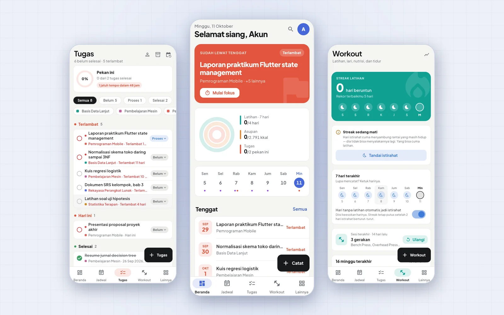

# Tracking



**[Unduh APK terbaru](https://github.com/Reverseflash45/Tracking/releases/latest)** · Android 8.0+, arm64 (arm32 untuk HP lama)

Aplikasi pencatat pribadi untuk mahasiswa yang menyatukan jadwal kuliah,
tugas, latihan di gym, lari, makan, tidur, dan keuangan. Datanya tersimpan di
Supabase dan tetap bisa dibuka tanpa sinyal.

Ada akun demo berisi data rekaan. Ketuk *Coba dengan akun demo* di halaman
masuk.

## Fitur

**Kuliah**
- Jadwal per hari dan pekan, dengan peringatan kalau ada kelas yang bentrok.
- Impor KRS dari foto atau screenshot. Dibaca AI lewat Edge Function. Kalau
  offline atau kuotanya habis, KRS dibaca di HP dengan ML Kit OCR.
- Impor KHS untuk menghitung IPS dan IPK, serta presensi per mata kuliah.
- Tugas dikelompokkan per tenggat (terlambat, hari ini, pekan ini), dengan
  filter per mata kuliah, tugas berulang, mode fokus, dan arsip.

**Latihan**
- Catat sesi gym per gerakan dan set, dengan template dan program latihan.
- Saran *progressive overload* dari riwayat, grafik progres per gerakan, dan
  panduan latihan per kelompok otot yang tetap terbuka tanpa internet.
- Hitung repetisi squat, push-up, dan bicep curl lewat kamera (ML Kit Pose
  Detection).
- Lari dengan GPS: rute di peta, pace, dan kartu hasil untuk dibagikan.
- Streak latihan dengan hari istirahat otomatis. Streak putus kalau istirahat
  lebih dari 2 hari berturut-turut. Riwayat bisa diekspor ke `.txt`.

**Badan dan kesehatan**
- Kalori harian dari profil badan, catatan makan dengan makro, air minum, dan
  taksiran porsi dari foto makanan.
- Catatan tidur, foto progres, dan data Health Connect (langkah, detak jantung
  istirahat, dan tidur dari jam pintar).

**Keuangan**
- Pemasukan dan pengeluaran per kategori, grafik bulanan, dan tagihan berulang.
- Baca struk belanja dengan OCR, dan pindai barcode.

**Lainnya**
- Rutinitas harian dan berkala dengan pengingat, target, catatan, wishlist,
  watchlist, kendaraan (servis dan pajak), dan dokumen penting.
- *Wrapped* mingguan, bulanan, dan tahunan dalam bentuk story.
- Halaman *Pola* yang membandingkan pekan rajin olahraga dengan pekan jarang
  olahraga, misalnya seberapa awal tugas diselesaikan sebelum tenggat. Pola
  baru ditampilkan kalau tiap kelompok punya cukup banyak pekan.
- Pencarian global dan tanya data dengan bahasa bebas.
- Widget layar utama (rutinitas dan catat cepat), kunci app dengan sidik jari
  atau PIN, cadangan otomatis mingguan, dan rekap mingguan lewat notifikasi.

## Keputusan teknis

| Keputusan | Alasan |
|---|---|
| Supabase dengan Row Level Security | Tanpa server sendiri. Setiap baris hanya bisa dibaca pemiliknya, termasuk lewat skrip. |
| Cache lokal berupa berkas JSON | Jadwal dan tugas tetap terbuka di ruang kuliah tanpa sinyal. SharedPreferences dihindari karena dibaca seluruhnya ke memori saat app dibuka. |
| Antrean tulis hanya untuk catatan baru | Lari 10 km tanpa sinyal tetap tersimpan. Mengubah dan menghapus sengaja butuh sinyal supaya tidak ada konflik yang diam-diam menimpa data. |
| Kunci AI hanya di Edge Function | Kunci yang dibundel ke APK bisa dibongkar. Fungsi `tanya` hanya menerima ringkasan data, bukan catatan mentah. |
| Gemini dulu, Claude sebagai cadangan | Penyedia dipilih dari secret yang tersedia. Pembaca KRS kembali ke OCR di HP kalau keduanya tidak bisa dipakai. |
| Cek pembaruan lewat GitHub Releases | App tidak ada di Play Store, jadi pengguna diberi tahu versi baru lewat API publik GitHub. |
| Laporan error ke tabel sendiri | Crash di HP orang lain tetap ketahuan tanpa layanan pihak ketiga. Hanya aktif di build rilis dan bisa dimatikan. |

## Struktur

```
lib/
  core/        router, tema, Supabase, cache & antrean offline, notifikasi,
               OCR, kunci app, cek pembaruan, pelapor error
  features/    satu folder per fitur (29), masing-masing data/ domain/ presentation/
supabase/
  migrations/  29 migrasi SQL beserta kebijakan RLS
  functions/   baca-krs, foto-makanan, tanya (Deno)
scripts/       isi_demo.py (isi akun demo), make_icons.py
rilis/         catatan rilis per versi
test/          1.059 unit test dan widget test
```

Stack: Flutter, Riverpod, go_router, Supabase, fl_chart, flutter_map, ML Kit
(pose, OCR, barcode), Health Connect, home_widget, dan local_auth.

## Menjalankan

1. Buat proyek Supabase, lalu jalankan migrasinya:
   ```
   supabase link --project-ref <ref>
   supabase db push
   ```
2. Salin `.env.example` menjadi `.env` dan isi:
   ```
   SUPABASE_URL=...
   SUPABASE_ANON_KEY=...
   ```
3. (Opsional) Untuk fitur AI, deploy Edge Function dan isi salah satu secret:
   ```
   supabase functions deploy baca-krs
   supabase functions deploy foto-makanan
   supabase functions deploy tanya
   supabase secrets set GEMINI_API_KEY=...      # atau ANTHROPIC_API_KEY
   ```
4. Jalankan:
   ```
   flutter pub get
   flutter test
   flutter run
   ```

Build rilis: `flutter build apk --release --split-per-abi`.

Akun demo bisa diisi ulang dengan data rekaan kapan saja lewat
`python scripts/isi_demo.py`. Skrip ini memakai token akun itu sendiri, jadi
RLS tetap berlaku.
